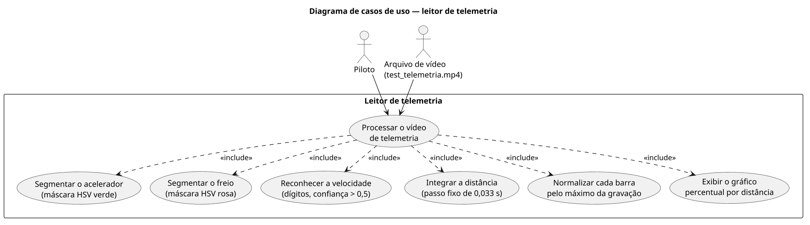
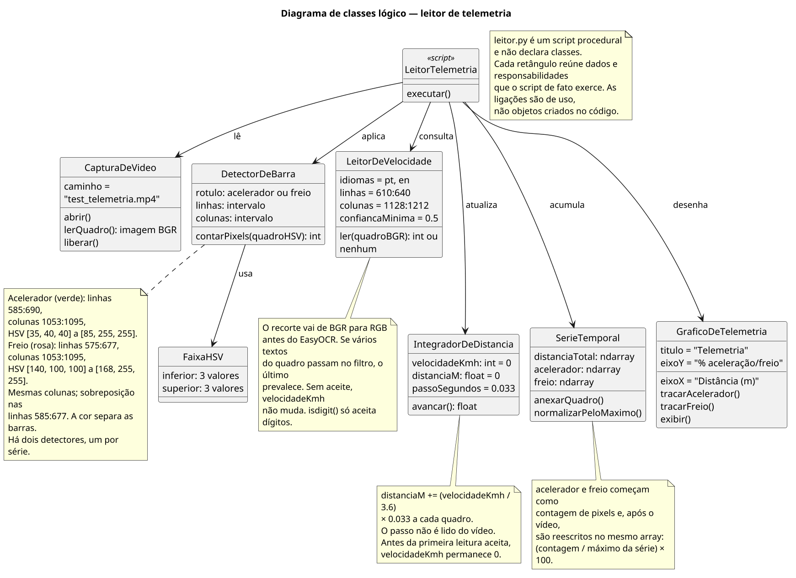
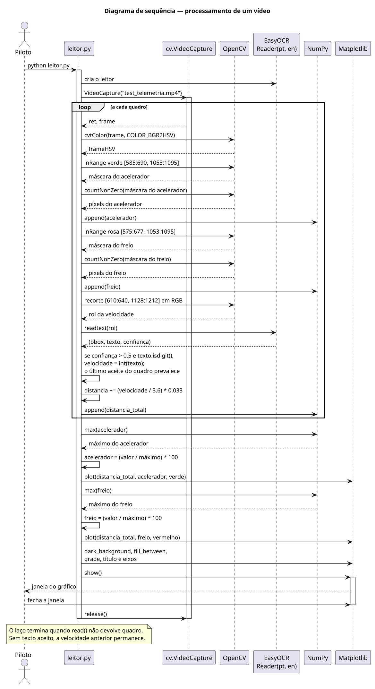
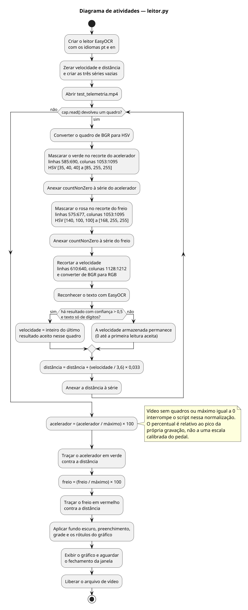

# Diagramas UML do leitor de telemetria

As quatro figuras desta pasta foram desenhadas a partir de `leitor.py`. Cada seção traz a imagem e, em seguida, um parágrafo que pode ser copiado para o capítulo de Metodologia. A numeração (Figura X) fica a cargo do texto do TCC. Sugestão de crédito sob a figura, porque o desenho é de autoria do trabalho: **Elaborada pelo autor.**

O script é procedural. O diagrama de classes não descreve classes declaradas no código; ele organiza os dados e as responsabilidades que o script exerce. Essa ressalva está no parágrafo correspondente e também na própria figura.

## Casos de uso

O diagrama de casos de uso delimita o sistema leitor de telemetria e os dois atores externos que participam de toda execução: o piloto de Le Mans Ultimate, que dispara o script sobre a gravação do stream porque a telemetria do jogo ficou no servidor do serviço de nuvem, e o arquivo de vídeo `test_telemetria.mp4`, que fornece os quadros do HUD capturado dessa transmissão. O caso de uso principal, processar o vídeo de telemetria, inclui obrigatoriamente seis passos que o programa não torna opcionais. São eles a segmentação da barra verde do acelerador por máscara HSV, a segmentação da barra rosa do freio pelo mesmo tipo de máscara, o reconhecimento da velocidade apenas quando o texto é composto de dígitos e a confiança supera 0,5, a integração dessa velocidade em distância com passo fixo de 0,033 s, a normalização de cada barra pelo máximo observado na gravação e a exibição do gráfico de percentual por distância. As setas de inclusão partem do caso de uso principal.

## Classes

O diagrama de classes é um modelo lógico. O arquivo `leitor.py` não declara classes nem objetos: é um script procedural, e as ligações da figura indicam uso, não instanciação. Cada retângulo agrupa uma responsabilidade presente no código. A captura abre, lê e libera `test_telemetria.mp4`. Dois detectores de barra, um para o acelerador e outro para o freio, aplicam uma faixa HSV a um recorte fixo e devolvem a contagem de pixels; os recortes compartilham as colunas 1053:1095 e se sobrepõem nas linhas 585:677, de modo que a cor é o que separa as séries. O leitor de velocidade consulta o retângulo 610:640 por 1128:1212 com EasyOCR nos idiomas português e inglês. O integrador acumula `(velocidade / 3,6) × 0,033` metros por quadro e conserva a última velocidade aceita. A série temporal guarda distância, acelerador e freio e, ao fim do vídeo, reescreve as contagens como percentual do máximo de cada uma. O gráfico traça as duas curvas e as exibe com os rótulos definidos no script.

## Sequência

O diagrama de sequência mostra uma execução completa, na ordem das chamadas do script. O piloto inicia `leitor.py`, que cria o leitor EasyOCR para português e inglês e abre `test_telemetria.mp4`. Em cada quadro, o OpenCV converte a imagem de BGR para HSV, gera a máscara verde do acelerador e a máscara rosa do freio, conta os pixels de cada máscara e recorta a velocidade já em RGB. O EasyOCR devolve texto e confiança; o script só substitui a velocidade quando a confiança é maior que 0,5 e o texto contém somente dígitos, prevalecendo o último aceite daquele quadro. Em seguida a distância é atualizada com o passo de 0,033 s e as três séries crescem com `append`. Encerrado o vídeo, o NumPy fornece o máximo de cada barra, o script converte as contagens em percentual e o Matplotlib desenha a curva verde e a curva vermelha, aplica o fundo escuro e só então exibe a janela. O arquivo de vídeo é liberado depois que essa janela se fecha.

## Atividades

O diagrama de atividades descreve o mesmo fluxo como um procedimento único. A execução prepara o leitor OCR, zera velocidade e distância, cria as séries vazias e abre o vídeo. Enquanto `cap.read()` devolve um quadro, o script converte a cor para HSV, mascara e conta o verde do acelerador, mascara e conta o rosa do freio, reconhece o texto da velocidade e decide se atualiza o inteiro armazenado ou se o conserva. A distância daquele quadro é então anexada à série. Ao fim das leituras, cada série de pixels é dividida pelo próprio máximo e multiplicada por 100, o acelerador é traçado em verde, o freio é traçado em vermelho, e a figura recebe fundo escuro, preenchimento, grade e rótulos antes de ser exibida. A liberação do arquivo ocorre somente depois do fechamento da janela. A figura também registra que um vídeo sem quadros, ou uma série cujo máximo é zero, interrompe o script na normalização, e que o percentual é relativo ao pico da gravação.
